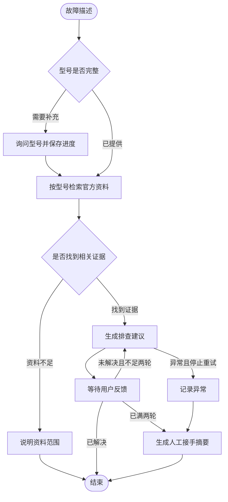

# Tapo 智能售后助手

基于 LangChain、LangGraph 与 RAG 的摄像头智能问答与排障系统，支持官方资料引用、多轮交互、进度恢复和人工接手摘要。

面向 TP-Link Tapo C200、C210，覆盖配网、离线、存储卡、录像、通知、画面和声音等常见问题。系统将故障描述与适用型号的官方资料匹配，结合用户反馈推进排查，并保存完整处理记录。

## 核心功能

- **官方知识库检索** — 按设备型号筛选资料，保留来源链接、适用范围和核对日期。
- **双模式交互** — LangChain 提供资料问答与通用问答，LangGraph 提供有状态的多轮排障流程。
- **上下文理解** — 支持连续追问；用户原问题与检索改写分别处理，保留完整对话语义。
- **进度保存与恢复** — 每笔排障使用独立编号，SQLite 保存检查点，支持退出后继续。
- **排障过程留痕** — 追加记录建议与用户反馈，达到排障轮数上限后生成人工接手摘要。
- **异常恢复** — 生成节点配置自动重试和错误处理，支持从已保存的进度继续未完成步骤。

知识库包含 **26 条排障资料、14 个官方来源**，配套 **60 道问题和 4 个多轮场景**，用于覆盖常见咨询和检查检索结果。

## 快速开始

需要 Python 3.11 和 DeepSeek API Key。

```bash
python3.11 -m venv .venv
source .venv/bin/activate
python -m pip install -r requirements.txt
cp .env.example .env
```

在 `.env` 中填写密钥。

```ini
DEEPSEEK_API_KEY=your_deepseek_api_key
```

已有 Conda 环境时，也可以激活现有环境后安装依赖。

### 多轮排障

```bash
python hardware_graph.py
```

选择新建排障并描述故障，再按提示提供型号。等待反馈时输入 `/exit` 保存进度并返回菜单，重新启动后可选择原编号继续或查看记录。问题解决后输入 `已解决` 结束该笔排障。

```text
请描述故障：换了路由器后，摄像头连不上 Wi-Fi
摄像头型号：Tapo C200

系统检索适用资料并给出建议
用户反馈操作结果
系统决定结束、继续下一轮或生成接手摘要
```

### 资料问答与一般问答

```bash
python main.py --dataset hardware --device-model C200
```

支持直接提问和连续追问，例如“存储卡一直提示未检测到”“格式化它会删除以前的录像吗”。也可以进行常识解释、学习交流和写作等一般问答。

相关资料优先作为依据，引用使用本轮编号和官方链接。资料不足时允许结合模型自身知识回答，并标明通用知识内容。输入 `/new` 开启独立会话，`/exit` 退出。型号用于当前会话的资料筛选，更换设备时重新启动并指定型号。

| 入口 | 主要能力 | 状态保存 |
| --- | --- | --- |
| `hardware_graph.py` | 收集型号、检索、两轮排障、异常处理、接手摘要 | SQLite 检查点 |
| `main.py --dataset hardware` | 官方资料问答、通用问答、历史追问、引用校验 | 当前进程内的会话历史 |

首次使用会下载 `BAAI/bge-small-zh-v1.5`。嵌入与相似度检索在本地运行；生成回答时，问题、相关资料及必要的会话历史会发送到已配置的 DeepSeek 服务，并产生 API 用量。

## 支持场景

| 类别 | 典型问题 |
| --- | --- |
| 配网 | 更换路由器、隐藏 SSID、Tapo_Cam 热点、配对失败、获取 IP 失败 |
| 离线 | 反复掉线、供电不稳、远程无法观看、信号较弱 |
| 存储与录像 | microSD 不识别、初始化失败、录像缺失、录制计划、历史回放 |
| 通知与侦测 | 推送缺失、通知延迟、侦测区域和灵敏度 |
| 图像 | 实时画面卡顿、隔玻璃夜视反光、倒装画面颠倒 |
| 声音 | 回放无声、现场声音缺失、双向对讲异常 |

型号支持 `C200`、`C210`、`Tapo C200`、`TP-Link Tapo C210` 等写法。资料记录适用型号与版本；规格条目对应 C200 V1、C210 V1，版本相关操作需核对设备标签、固件和 App。Tapo 系列通过 Tapo App 和 TP-Link ID 使用，操作以对应地区和版本的厂商说明为准。

## 排障流程



共享状态记录故障、型号、证据、建议轮数和反馈。过程日志使用 reducer 追加，`interrupt()` 保存等待用户回答的位置，`Command` 提交回答或控制后续路由。

生成节点最多执行三次，包含首次执行。停止重试后，错误处理函数记录失败并生成接手摘要。恢复记录时，根据检查点选择继续执行、等待回答或展示最终结果。

接手摘要包含设备型号、故障描述、建议轮数和完整排障过程，供人工继续处理。设备操作由用户执行；涉及重置、移除设备和格式化时，回答需说明配置或数据影响并先确认用户意愿。

## 知识库与问题集

两种交互模式共用 `hardware_data/knowledge.json` 和 `hardware_data/questions.json`。

| 资料字段 | 用途 |
| --- | --- |
| `id` | 稳定的资料编号 |
| `device_models` | 适用型号，检索时过滤 |
| `topic`、`title`、`symptoms` | 类别、标题和常见问题描述 |
| `content`、`scope` | 排障步骤和适用范围 |
| `source_ids`、`reviewed_on` | 官方来源与核对日期 |

每条资料作为完整检索单元，使用 BGE 中文嵌入。检索按型号筛选，返回相似度不低于 `0.5` 的前 `3` 条资料。LangChain 回答模型接收原问题、会话历史和检索证据；问题改写只用于检索。

### 更新资料

修改资料后，重新启动 LangGraph 入口即可加载。LangChain 模式使用独立的本地索引，按以下命令重建。

```bash
python main.py --dataset hardware --device-model C200 --rebuild-index
```

只重建索引时运行以下命令。

```bash
python -c 'from main import build_vector_store; build_vector_store(dataset="hardware", rebuild_index=True)'
```

已有排障记录保留当时使用的证据与日志。更新资料后的新排障会使用新内容。

### 检索检查与场景演示

```bash
# 列出问题和多轮场景
python hardware_questions.py

# 检查预期证据命中和检索出口
python hardware_questions.py --check-retrieval

# 演示 LangChain 检索、追问和引用
python demo.py --dataset hardware --device-model C210
```

检索检查在本地运行；首次使用需要下载嵌入模型。已有缓存时可设置 `HF_HUB_OFFLINE=1`。多轮问答演示调用 DeepSeek，产生 API 用量。

问题集覆盖常见咨询、型号边界与口语表达。检查结果统计证据命中和检索出口，模型回答质量与现场处理结果需分别评估。

## 技术栈与项目结构

| 技术 | 用途 |
| --- | --- |
| LangGraph | 节点编排、条件路由、循环、暂停恢复和错误处理 |
| LangChain | 提示词、检索问答链、会话历史和引用处理 |
| DeepSeek | 建议生成、通用问答和检索问题改写 |
| BGE / Sentence Transformers | 本地中文文本嵌入 |
| InMemoryVectorStore | 相似度检索与本地索引序列化 |
| SQLite | 排障状态持久化 |

```text
.
├── hardware_graph.py             # 多轮排障与终端入口
├── hardware_knowledge.py         # 资料加载、型号归一化与检索
├── hardware_questions.py         # 问题集与检索检查
├── hardware_data/
│   ├── knowledge.json            # 官方资料摘要与来源
│   └── questions.json            # 问题、预期证据与多轮场景
├── main.py                       # LangChain 问答入口
├── demo.py                       # 检索、追问与引用演示
├── data/                         # 本地文本资料
├── requirements.txt
└── .env.example
```

`main.py` 也支持 `data/*.txt` 本地文本资料，默认选择该资料模式。使用以下命令进入文本问答或更新其索引。

```bash
python main.py
python main.py --rebuild-index
```

`.env`、本地向量索引及排障数据库已加入 Git 忽略规则。

## 官方资料来源

以下网页于 2026-11-11 核对。中文内容为精简摘要，详细图示、版本变化和后续更新以厂商原文为准。

| 内容 | 原始来源 |
| --- | --- |
| C200 V1 无线规格 | [Tapo C200 V1 Specifications](https://www.tapo.com/en/product/tapo-c200-security-camera/v1/1-pack/specs) |
| C210 V1 无线规格 | [Tapo C210 V1 Specifications](https://www.tapo.com/en/product/tapo-c210-security-camera/v1/1-pack/specs) |
| 初次设置与更换网络 | [Tapo 官方设置指南](https://www.tapo.com/en/faqs/how-to-set-up-your-tapo-camera-using-the-tapo-app) |
| 无线配网失败 | [TP-Link 配网排障](https://www.tp-link.com/us/support/faq/2747/) |
| 离线、远程观看与卡顿 | [Tapo 观看异常排障](https://www.tapo.com/en/faqs/tapokasa-camera-not-working-cannot-view-camera-troubleshooting-guide) |
| 信号强度 | [TP-Link 信号检查](https://www.tp-link.com/us/support/faq/3261/) |
| 恢复出厂设置 | [Tapo 重置指南](https://www.tapo.com/us/faqs/how-to-factory-reset-your-tapo-camera-two-methods) |
| 插卡和格式化 | [TP-Link microSD 设置](https://www.tp-link.com/us/support/faq/3088/) |
| 存储卡不识别或格式化失败 | [TP-Link 存储卡排障](https://www.tp-link.com/us/support/faq/2749/) |
| 录像计划与回放 | [TP-Link 录像设置](https://www.tp-link.com/us/support/faq/2617/) |
| 通知缺失与延迟 | [TP-Link 通知排障](https://www.tp-link.com/us/support/faq/4853/) |
| 侦测区域与隔玻璃影响 | [TP-Link 侦测排障](https://www.tp-link.com/us/support/faq/3418/) |
| 倒置画面 | [TP-Link 画面旋转设置](https://www.tp-link.com/us/support/faq/2625/) |
| 回放与对讲无声 | [TP-Link 声音排障](https://www.tp-link.com/us/support/faq/4958/) |
